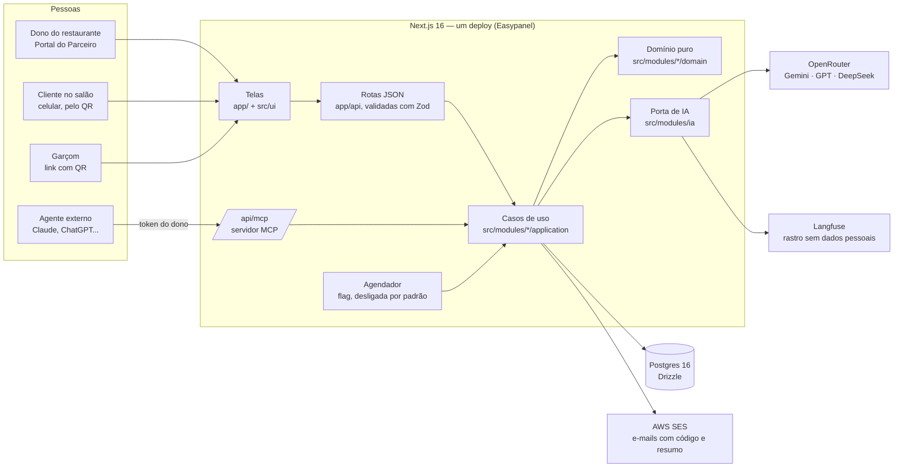
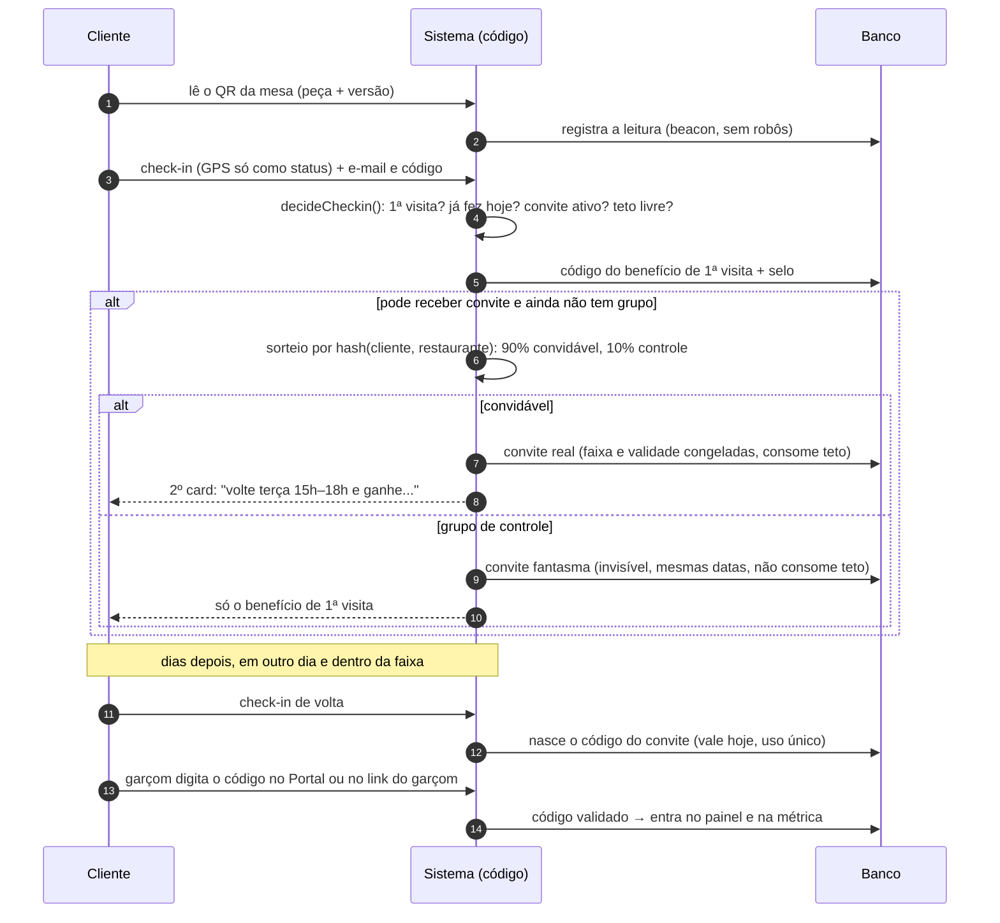
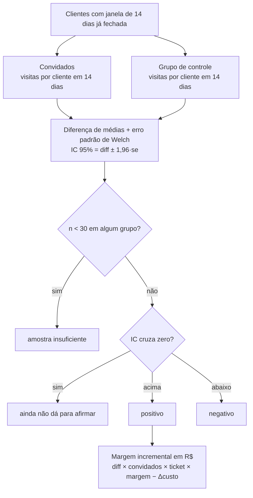
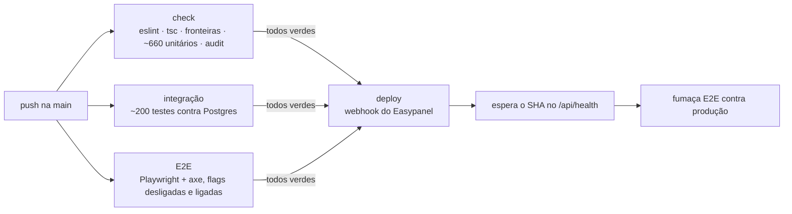

# Arquitetura

Como o protótipo é montado, por onde passam os dados e por que cada peça está onde está. Para o produto, veja o [README](../README.md); para a IA em detalhe, [ia-no-produto.md](ia-no-produto.md); para o porquê das escolhas, [decisoes-principais.md](decisoes-principais.md).

## Em uma frase
Um **monólito modular** em Next.js 16 (App Router, TypeScript estrito) sobre **Postgres 16**, com a IA isolada atrás de uma porta (`src/modules/ia`) que fala só com o **OpenRouter**. Um deploy, um banco, regras de negócio em funções puras testadas, e a IA usada só onde ela faz algo que o código não faz bem (ler cardápio, escolher entre ofertas válidas e escrever).

## Visão geral

- **Telas e rotas não têm regra de negócio.** Elas chamam casos de uso; os casos de uso chamam o domínio, o banco e a IA.
- **O domínio não importa nada de fora** (nem Next, nem banco, nem IA). Isso é conferido no CI por `npm run check:boundaries` ([dependency-cruiser](../.dependency-cruiser.cjs)): se alguém importar o banco dentro de `domain/`, o build quebra.
- **O MCP é só outra porta de entrada.** Ele chama os mesmos casos de uso que o Portal (D267), com o token do dono e as mesmas validações.

## Módulos (`src/modules/*`)
Cada módulo tem `domain/` (regras puras), `application/` (casos de uso) e, quando precisa, `adapters/`.

| Módulo | O que faz | Arquivos para começar |
|---|---|---|
| `salao` | Check-in, sorteio do grupo de controle, convites, códigos, clientes, validação do garçom | [`decide-checkin.ts`](../src/modules/salao/domain/decide-checkin.ts), [`experiment.ts`](../src/modules/salao/domain/experiment.ts), [`invite-window.ts`](../src/modules/salao/domain/invite-window.ts) |
| `beneficios` | Benefício de 1ª visita, ofertas candidatas, horários vazios (faixas), cartela, códigos | [`offers.ts`](../src/modules/beneficios/domain/offers.ts), [`slots.ts`](../src/modules/beneficios/domain/slots.ts), [`codes.ts`](../src/modules/beneficios/domain/codes.ts) |
| `onboarding` | Ativação em 5 passos: cardápio → salão → revisão → pacote proposto → ativar | [`package.ts`](../src/modules/onboarding/application/package.ts), [`activate.ts`](../src/modules/onboarding/application/activate.ts) |
| `planos` | Plano da semana: fatos, candidatas, IA que escolhe, aprovação, reativação | [`generate-plan.ts`](../src/modules/planos/application/generate-plan.ts), [`reactivation.ts`](../src/modules/planos/domain/reactivation.ts) |
| `analytics` | Incremento contra o grupo de controle (Welch), funil, insights, veredito por oferta, A/B | [`incremental.ts`](../src/modules/analytics/domain/incremental.ts), [`verdict.ts`](../src/modules/analytics/domain/verdict.ts) |
| `kit` | Peças impressas (display, cartaz, cartão do garçom) com QR por peça e versão | [`generate-kit.ts`](../src/modules/kit/application/generate-kit.ts) |
| `agente` | Assistente do salão: pedido → proposta tipada → conferida pelo código → "Aplicar" | [`proposals.ts`](../src/modules/agente/domain/proposals.ts), [`catalog.ts`](../src/modules/agente/application/catalog.ts) |
| `mcp` | Servidor MCP sobre o mesmo catálogo de ferramentas | [`server.ts`](../src/modules/mcp/server.ts) |
| `ia` | Porta única de IA: tarefas, modelos, reserva, guardrails, custo, rastro | [`run-task.ts`](../src/modules/ia/run-task.ts), [`guardrails/index.ts`](../src/modules/ia/guardrails/index.ts), [`models.ts`](../src/modules/ia/models.ts) |
| `simulacao` | Gerador dos 60 dias do restaurante de exemplo, com as mesmas funções do produto | [`generator.ts`](../src/modules/simulacao/domain/generator.ts) |
| `agendador` | Gera o plano e manda o resumo no dia e hora do dono; lembrete do convite | [`tick.ts`](../src/modules/agendador/application/tick.ts) |
| `contas` | Login por e-mail + código, link do avaliador, cópia do restaurante de exemplo por conta | [`copy-vitrine.ts`](../src/modules/contas/application/copy-vitrine.ts) |
| `config` | Flags e prompts editáveis ao vivo, com versões | [`flags.ts`](../src/modules/config/domain/flags.ts) |
| `textos` | Textos escritos pelo código (modo sem IA, e-mails) | — |

## O fluxo principal, do QR à volta

**Por que o "convite fantasma":** o grupo de controle precisa ser comparável. O sorteio só acontece entre quem **poderia** receber convite naquele momento (plano ativo, sem convite ativo, teto livre), e o cliente do controle ganha um convite invisível com as mesmas datas. Assim a janela de 14 dias começa no mesmo ponto para os dois grupos (intenção de tratar, D216). Sem isso, o sistema compararia "quem chegou no começo da semana" com "todo mundo".

## Como a métrica é calculada

- Código: [`src/modules/analytics/domain/incremental.ts`](../src/modules/analytics/domain/incremental.ts). Detalhes e limites na [especificação §2](planejamento/especificacao.md#2-métricas-árvore).
- **Proteção contra migração:** a mesma conta é feita para as visitas **fora** do horário vazio. Se o convite só troca o cliente de sábado para terça, essa comparação mostra.
- **"Visitas registradas" são check-ins.** Quem volta sem fazer check-in não aparece; em produção, cruzaríamos com pagamento ou reserva.
- **Limites estatísticos declarados:** o intervalo usa aproximação normal; o painel é olhado a qualquer momento, sem correção para leituras repetidas; o sorteio é por cliente (pessoas da mesma mesa podem cair em grupos diferentes); o intervalo da margem não inclui a incerteza do ticket e da margem que o dono informou. Por isso a prova fica para um piloto com critério definido antes.

## Dados (Postgres + Drizzle)
36 tabelas em [`src/db/schema`](../src/db/schema), em 12 migrações versionadas ([`drizzle/`](../drizzle)). Os grupos:

| Grupo | Tabelas | Regras que valem |
|---|---|---|
| Contas e restaurantes | `owners`, `restaurants`, `idle_slots`, `login_codes`, `mcp_tokens`, `waiter_tokens` | Todo dado pertence a um restaurante; o restaurante vem sempre da sessão, nunca do corpo da requisição |
| Cardápio e ofertas | `menus`, `menu_items`, `menu_extractions`, `benefits`, `benefit_versions` | Ofertas versionadas: mudar a regra não muda convites já emitidos |
| Kit | `kit_pieces`, `piece_variants` | Um QR por peça e versão (atribuição e A/B) |
| Clientes | `customers`, `customer_contacts`, `restaurant_customers`, `customer_login_codes`, `customer_messages` | E-mail e telefone guardados como HMAC (busca) e criptografados (AES-256-GCM); o grupo do experimento é gravado uma única vez |
| Eventos (só inserção) | `scans`, `checkins`, `codes`, `invites`, `invite_quota` | Chave de idempotência; teto reservado sob lock (`SELECT … FOR UPDATE` na linha do teto + recontagem dos convites reais); no máximo 1 convite ativo por cliente (índice único parcial) |
| Planos e IA | `weekly_plans`, `plan_sends`, `plan_send_members`, `weekly_digests`, `digest_tokens`, `owner_edits`, `ai_calls`, `agent_proposals`, `onboarding_events` | Toda chamada de IA registrada com modelo, versão do prompt, custo, latência e resultado dos guardrails |
| Configuração e proteção | `app_config`, `app_config_versions`, `rate_limits`, `simulation_runs` | Flags e prompts com versões imutáveis; limites por IP, e-mail e global |

Datas em UTC, com o dia e o turno calculados em `America/Sao_Paulo` (testado com relógio fixo, inclusive na virada da semana).

## Segurança e privacidade
- **Login sem senha:** e-mail + código de 6 dígitos (AWS SES), para dono e cliente. O e-mail fica como HMAC (para achar a conta) e criptografado com AES-256-GCM, com chave derivada por HKDF.
- **Contato nunca sai do banco para a IA, logs, rastros ou MCP.** O Assistente do salão e o MCP veem só o primeiro nome com a inicial (D262, D268).
- **Sessões** em cookie assinado (`httpOnly`, `Secure`, `SameSite=Lax`); CSP e cabeçalhos de segurança; `noindex` em tudo; corpo JSON limitado a 64 KB.
- **Isolamento por conta:** cada conta ganha a própria cópia do restaurante de exemplo (D119); um teste E2E garante que a conta 2 não abre nem valida nada da conta 1.
- Detalhes: [especificação §4.6](planejamento/especificacao.md#46-segurança-e-privacidade-t6).

## Configurável sem deploy
- **Flags** ([`flags.ts`](../src/modules/config/domain/flags.ts)) ligam e desligam recursos inteiros ao vivo, em Bastidores › Configurações (protegido por senha): A/B, revisor, plano como agente, assistente, MCP, agendador e outros.
- **Prompts** (o bloco de instruções e tom de cada tarefa) são editáveis com "testar com exemplo" antes de publicar e "voltar versão". O schema e os guardrails ficam no código, de propósito.
- **O dono** configura o próprio restaurante: benefício, horários vazios, teto, cartela, tom da IA, avisos e automação.

## Testes e entrega

- **Domínio por TDD:** sorteio, teto por semana ISO (inclusive com check-ins simultâneos), convite congelado, códigos, incremento e migração, e um teste que garante que o simulador recupera o efeito programado.
- **E2E em produção depois de cada deploy**, com contas de teste que não gastam a chave de IA pública (D293). Há também um workflow manual só de fumaça ([`fumaca-producao.yml`](../.github/workflows/fumaca-producao.yml)).
- **Rollback:** revert na `main`, que passa de novo pelo CI. As migrações só vão para frente (sem "down"); o procedimento e as ressalvas estão em [notas-infra.md](planejamento/notas-infra.md).

## Hospedagem
- VPS própria com **Easypanel**: um serviço Node 22 (Next `standalone`, `Dockerfile`) e um Postgres 16 só na rede interna. Migrações e seed rodam no boot (`instrumentation.ts`), nunca no build.
- **Por que não Vercel + banco gerenciado:** a VPS já existia, sem custo adicional, e o build no próprio servidor foi testado contra o limite de memória (D90). O preço: deploy mais lento (2–4 min de build) e um servidor só.

## O que mudaria para escalar (roadmap)
O protótipo foi feito para provar o produto, não para 400 mil restaurantes. Numa versão de produção:
- **fila e jobs** no lugar do agendador em processo e da fila de cópias em memória;
- **login iFood real** e QR que abre o app (deep link);
- **dados do restaurante vindos do iFood** (cardápio, horários, ticket) em vez de foto e números declarados (D276);
- **reativação pelo CRM/Giftback** do Comer Fora, em vez do e-mail próprio;
- **provedores de IA adequados à LGPD** para transferência internacional, e consentimento de marketing desligado por padrão.

O roteiro completo está na [especificação §9](planejamento/especificacao.md#9-roadmap-fora-do-protótipo).
