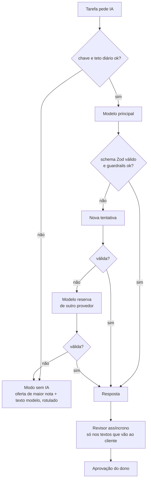
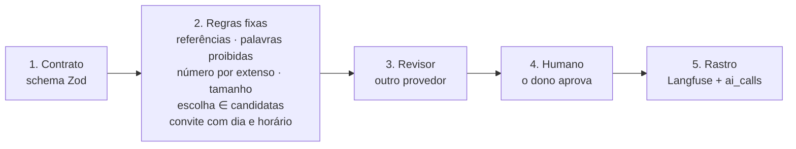

# IA no produto

Onde a IA entra, onde **não** entra, como ela é protegida, quanto custa e o que foi medido de verdade. Para a construção com IA (como o projeto foi feito), veja [processo-com-ia.md](processo-com-ia.md).

## O princípio: o código decide números e dinheiro; a IA escolhe entre opções válidas e escreve
O briefing avisa: "uma conversa com IA, sozinha, não é um produto". Aqui a IA faz o que o código faz mal (ler uma foto de cardápio, casar item com horário, escrever na voz do restaurante, entender um pedido em português) e **nunca** decide preço, custo, teto, sorteio do grupo de controle ou resultado. Isso é imposto pelo código, não por instrução no prompt:

- **Referências em vez de valores.** A IA escreve `{prato:p3}`, `{horario:s1}`, `{fato:uso_convites}`, e o código troca pelos valores reais. Um número escrito pela IA, inclusive por extenso ("metade", "dez"), reprova o texto.
- **Escolha dentro de uma lista.** Na ativação e no plano da semana, o código calcula 2–3 ofertas válidas por horário vazio (item do cardápio, custo dentro do teto, tipo permitido) e a IA devolve o **id** de uma delas. Um id que não existe reprova a resposta.
- **Nada vai ao cliente sem o dono.** Pacote, plano, kit e mudanças do assistente só valem depois do clique do dono.

## As tarefas

| Tarefa | O que a IA faz | Modelo (reserva) | Prompt em produção | Medido? |
|---|---|---|---|---|
| Leitura do cardápio | Foto ou PDF → itens, preços e categorias em JSON | `gemini-3.1-flash-lite` (`gpt-6-luna`) | `cardapio-v1` | Sim, T1 (nesta versão) |
| Pacote da ativação | Escolhe a oferta de cada horário vazio entre as candidatas, escreve o convite e a justificativa | `gemini-3.8-flash` (`gpt-6-luna`) | `pacote-v3` | T3 mediu a `pacote-v2` |
| Plano da semana | Igual ao pacote, mais "O que aprendemos" (explica o veredito que o código calculou). Roda como agente com ferramentas só de leitura | `gemini-3.8-flash`; se falhar, chamada única; se falhar, modo sem IA | `plano-agente-v4` (`plano-v3` na chamada única) | T3 do agente mediu a v3 |
| Kit (peças impressas) | Título, subtítulo e chamada do display e do cartaz | `gemini-3.8-flash` (`gpt-6-luna`) | `kit-v3` | Não (segue a escolha da T3) |
| Revisor | Confere os textos que chegam ao cliente: `ok`, `atenção` ou `bloquear` | `deepseek-v4.1-flash` (3º provedor, fora do laço dos outros) | `revisor-v2` | Só falso positivo, na v1 |
| Assistente do salão | Pedido do dono em português → proposta tipada (8 ações) | `gemini-3.8-flash` (`gpt-6-luna`) | `copiloto-v5` | Sim, T4 (nesta versão) |
| Frase do salão | Preenche "Seu salão" a partir de uma frase do dono | `gemini-3.8-flash` (`gpt-6-luna`), os mesmos do assistente | `salao-frase-v1` | Não |

Configuração dos modelos: [`src/modules/ia/models.ts`](../src/modules/ia/models.ts). As tarefas: [`src/modules/ia/tasks/`](../src/modules/ia/tasks).

## Caminho de uma chamada

- **O laço de reserva é nosso** ([`run-task.ts`](../src/modules/ia/run-task.ts)): a lista de modelos do OpenRouter só troca de modelo quando o provedor dá erro, não quando o JSON vem inválido ou quebra uma regra (D53).
- Cada tentativa tem tempo limite e a tarefa tem um orçamento total. Depois de ~45 s, o produto mostra o texto modelo em vez de esperar.
- O **modo sem IA** existe em todas as tarefas de geração. Se a chave acabar ou o provedor cair, o produto continua funcionando, com o rótulo "sem IA".

## Guardrails em camadas

Código: [`src/modules/ia/guardrails/index.ts`](../src/modules/ia/guardrails/index.ts). Alguns detalhes que vieram de falhas reais:
- **Proibir dígitos não funcionava** (D54): bloqueava "Pizza 4 queijos" e deixava passar "metade do preço". Por isso, referências + lista de palavras proibidas + números por extenso. O nome do restaurante é retirado antes da checagem, para não barrar um "Bar Dois Irmãos" (D283).
- **Convite sem dia e horário** (D226): o juiz da avaliação apontou convites vagos. Virou regra no código (`sem_horario`, `artigo_antes_do_horario`, `oferta_repetida`), com tabela de casos em teste unitário.
- **Assistente fora do escopo** (D277, D286): a IA classifica o pedido e, se for fora do restaurante ("escreve um poema"), a recusa é um texto fixo do código. Um portão determinístico ainda limita tamanho, formato e exige uma âncora no produto. Limite declarado: o portão garante formato e âncora, **não** o assunto.

## Prompt injection e dados pessoais
- **Texto que vem de fora é dado, não instrução:** a foto do cardápio, os nomes dos pratos, as instruções opcionais do dono ("IA do restaurante") e o pedido ao assistente. Tudo entra delimitado, limpo e com tamanho limitado; a saída é sempre um schema.
- **A IA não tem ferramenta de escrita.** O plano e o assistente só têm ferramentas de leitura; mudanças saem como **proposta tipada** que o código confere e o dono aplica (D261). Pelo MCP, um agente externo usa as mesmas propostas, com o token do dono (D269).
- **Contato de cliente nunca vai ao modelo.** O assistente e o MCP veem só primeiro nome + inicial e atributos (visitas, selos, segmento), por apelido (`{cliente:C3}`). O rastro do assistente não grava a conversa (D262, D268). Os nomes vão ao OpenRouter com `data_collection: deny`; em produção, o provedor teria de ser adequado à LGPD.

## Custo e limites
- **Duas chaves** no OpenRouter: a pública (visitantes), com teto diário de US$ 0,50, e a de demonstração (link do avaliador e apresentador). O orçamento total do projeto foi US$ 10 (D85).
- **Medido em produção** (Bastidores › Visão da plataforma): menos de US$ 0,01 de IA por restaurante ativado (cardápio, pacote e kit). Pela T3 do agente, o plano da semana custa ~US$ 0,014 como agente e ~US$ 0,002 como chamada única.
- Limites por IP, por e-mail e global, e o `/api/health` mostra o estado do teto.

## O que foi medido (avaliações em [`eval/`](../eval))
Todas com amostra pequena: servem para escolher o modelo e achar falhas, não para provar efeito.

| Avaliação | O que comparou | Resultado | Relatório |
|---|---|---|---|
| **T1** · leitura do cardápio | 7 modelos de visão e 3 linhas de base de OCR, em 4 cardápios (3 fictícios com gabarito + 1 foto real manuscrita), 2 repetições | Venceu `gemini-3.1-flash-lite`: nota 1,000; p50 2,4 s; US$ 0,0017 por cardápio. OCR + regras: 0,42–0,46; OCR + IA de texto: 0,73. Os melhores modelos empataram perto de 1,0 (os cardápios fictícios saturaram a nota) | [relatorio-t1.md](../eval/relatorio-t1.md) |
| **T3** · pacote e plano | 6 modelos × 5 cenários × 2 repetições; juiz de IA cego de um provedor que não concorre; nota cega do candidato | Venceu `gemini-3.8-flash` (regras ok em 90%; p50 2,8 s). Juiz e candidato preferiram a IA ao texto modelo em 8 de 9 pares; concordaram em 7 de 9 (κ 0,55) | [relatorio-t3.md](../eval/relatorio-t3.md), [t3-cego.md](../eval/t3-cego.md) |
| **T3 do agente** · plano como agente × chamada única | 3 rodadas de prompt, 5 cenários × 2 | Na última: os dois 10/10 nas regras; juiz 6 × 1 empate × 3 para o agente (sem significância); agente ~6,5× mais caro e ~3,8× mais lento | [relatorio-t3-agente.md](../eval/relatorio-t3-agente.md) |
| **T4** · assistente do salão | 16 pedidos com gabarito + 6 casos novos × 3 fora da amostra | Fora da amostra: `gemini-3.8-flash` 17/18, `gpt-6-luna` 14/18; escopo: 30/30 nos dois | [relatorio-t4-validacao.md](../eval/relatorio-t4-validacao.md), [relatorio-t4-escopo.md](../eval/relatorio-t4-escopo.md) |
| **Revisor** | 10 planos bons gerados pela IA | 0 bloqueados indevidamente, 3 com "atenção". Textos ruins de propósito ainda não foram testados | [resultados-revisor.json](../eval/resultados-revisor.json) |

### O que é ganho medido e o que é hipótese
- **Medido:** a IA lê o cardápio muito melhor que OCR (T1) e escreve convites e justificativas melhores que o texto modelo (T3).
- **Hipótese, ainda não provada:** que a **escolha** do item para cada horário feita pela IA rende mais visitas que a oferta de maior nota do código. No critério "item × turno", o modelo vencedor empatou com a linha de base em 3 de 4 cenários. Isso se mede num piloto, com restaurantes sem a escolha da IA.
- **Limites da própria avaliação:** a linha de base é o texto modelo do produto, reconhecível pelo formato, então os pares não são totalmente cegos. Os relatórios guardam também os erros reais dos textos da IA (por exemplo, "na sua domingo" e um convite que repetia o nome da oferta); foram eles que viraram as regras de convite da D226.
- **Versões:** os prompts em produção são, em alguns casos, uma versão mais nova que a medida (tabela acima). Nenhum número novo foi inventado para elas.

### Por que o plano da semana roda como agente
A regra combinada antes era ligar o agente só se ele passasse nas regras em ≥ 90%, com p50 ≤ 20 s e juiz não pior (D159). Na 1ª rodada ele perdeu no juiz; o candidato ligou mesmo assim, pela confiabilidade nas regras (10/10 contra 5/10 da chamada única), com a chamada única de reserva (D225). Na 3ª rodada, depois da regra de dia e horário (D226), a chamada única também chegou a 10/10. O que sobra a favor do agente é corrigir o próprio texto pelas regras antes de responder (`checar_texto`) e a preferência do juiz (6 × 3, sem significância), por ~6,5× o custo. A alternativa mais barata, a chamada única com uma rodada de reparo, fica registrada.

## Por que não…
- **…OCR primeiro, IA de reserva?** Foi medido (D128): o OCR lê as letras, mas não junta nome, preço e seção em cardápio de duas colunas, foto torta ou letra de mão. O híbrido custou mais e errou mais preços.
- **…LangChain ou LangGraph?** (D215) As tarefas são chamadas únicas com schema, e o humano no meio é um estado no banco (proposto → aprovado), não um grafo em memória. A camada própria (`src/modules/ia`) dá controle total do laço de reserva, dos guardrails e do rastro, sem uma dependência a mais. A decisão seria revista se o plano virasse um fluxo longo com várias etapas e estado entre elas.
- **…um chat?** O Toqan já é o chat do Portal, e o briefing diz que conversa sozinha não é produto (D211). O assistente do salão existe, mas **não executa nada**: o pedido vira um cartão "antes → depois" com custo calculado pelo código, e só o clique do dono aplica (D260, D261).
- **…um modelo só?** Cada tarefa tem exigências diferentes (visão, texto curto com referências, ferramentas). O modelo de cada uma saiu de avaliação, e a reserva é sempre de outro provedor. O assistente de código (Claude) declarou conflito de interesse na escolha e concorreu sem vencer (D51).

## Observabilidade
- **Langfuse** (região EU) recebe o rastro de cada chamada, sem dados pessoais e sem a conversa do assistente.
- A tabela `ai_calls` guarda tarefa, modelo servido, versão do prompt, tokens, custo, latência, uso da reserva e resultado dos guardrails. Ela alimenta a página pública **Qualidade da IA**, com custo por tarefa, bloqueios mais comuns e aceitação sem edição pelo dono.
