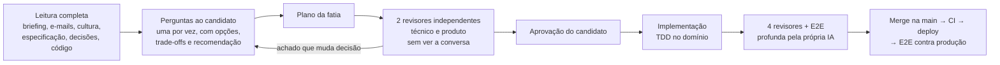

# Como o protótipo foi construído com IA

O briefing pede: "mostre o seu raciocínio", com **prompts** (como construiu e evoluiu os prompts e como conversou com a IA), **APIs** (quais APIs e ferramentas escolheu, e por quê) e **riscos**. Este documento conta o processo inteiro; o resumo em um slide está nos materiais da entrega.

## A divisão de trabalho
- **O candidato decidiu:** o problema, o recorte, cada decisão de produto e de risco, e quando aceitar ou recusar a recomendação da IA. As decisões dele estão marcadas como "candidato" (ou "U", nos registros mais antigos) em [decisoes-e-tradeoffs.md](planejamento/decisoes-e-tradeoffs.md).
- **A IA executou:** pesquisa, análise de alternativas, código, testes, avaliações de modelo e revisões. Quase todos os commits do repositório têm a IA como autora (assistente de código: Claude Code), e as mensagens de commit levam o link da sessão. Decisão que a IA tomou sozinha durante a implementação ficou marcada como "IA [C]", aberta a correção, e entrou no relatório da fatia.

## O método: perguntas → plano revisado → construção → revisão

O método virou 3 skills do projeto, versionadas em [`.claude/skills/`](../.claude/skills): `planejar-fatia`, `implementar-fatia` e `revisar-fatia`, sobre o pacote aberto *superpowers* (TDD, depuração sistemática, verificação antes de concluir). O projeto foi feito em 10 fatias (S0–S9 e S7), cada uma com o próprio planejamento em [`docs/fatias/`](fatias).

### Como a conversa funcionava
Pedido do candidato desde o 1º dia: análise crítica, sem inventar nem supor nada fora das fontes. Na prática:
- a IA lia todo o material antes de propor qualquer coisa;
- fazia **uma pergunta por vez**, com o que encontrou, por que importa, as opções, os trade-offs e uma recomendação;
- o candidato decidia, pedia explicação mais simples ou trazia uma ideia própria.

O registro completo, item por item, está em [log-conversa-ia.md](planejamento/log-conversa-ia.md).

## Momentos em que o candidato mudou o rumo da IA
| Momento | O que aconteceu | Efeito |
|---|---|---|
| Plano da S0 | Recusou aprovar sem uma revisão independente e pediu que isso virasse regra | Revisão com 2 subagentes antes de todo plano (D95). Na S0, achou 5 bloqueantes e 2 decisões de design com premissa errada da IA |
| Meio da construção | "Qual a grande diferença do que estamos construindo pra aquilo que já existe? Não vai ficar muito igual?" | Pesquisa mostrou que ~metade do escopo replicava o app. Replanejamento do produto com 4 revisões (D201–D224) |
| Antifraude | Trouxe a referência "tipo Duo Gourmet" | Código único por cliente validado pelo garçom (espec. 3.3) |
| Leitura do cardápio | "E se tentarmos OCR primeiro, com IA de reserva?" | Em vez de debater, medir: OCR entrou como linha de base da T1 e perdeu (D128) |
| Modelos | Pediu levantamento não enviesado, inclusive de concorrentes do assistente | A IA declarou conflito de interesse; juiz das avaliações de um provedor que não concorre (D51) |
| Conta demo | "Por que um terceiro entra na conta de outro?" | Login por e-mail + código e uma cópia do restaurante por conta (D118, D119) |
| Agente do plano | Ligou o agente contra a regra combinada e depois perguntou "e se adicionarmos teste determinístico?" | Regra de dia e horário no código, com tabela de casos (D225, D226) |
| Assistente | Pediu "agente em formato de chat"; ouviu o conflito com a decisão anterior | Assistente que só propõe; nada muda sem clique (D260, D261) |
| Dados de clientes | Queria que o modelo visse tudo; mudou depois da revisão | "Nome sim, contato não" (D262) |
| Escopo do assistente | "Não deve poder escrever um poema, por segurança" | Classificação + portão determinístico, refeito depois que a revisão de segurança o quebrou (D277, D286) |

## Prompts: como foram construídos e evoluíram
Cada tarefa de IA tem um prompt versionado (`pacote-v3`, `plano-agente-v4`, `copiloto-v5`…), um schema e guardrails no código. O bloco de instruções e tom pode ser editado ao vivo nos Bastidores, com "testar com exemplo" e "voltar versão"; o schema e as regras não. A evolução veio de falhas medidas:

1. **`{horario:FAIXA}` copiado ao pé da letra (T3, `pacote-v1` → `v2`).** Na 1ª rodada da avaliação, 3 modelos escreveram o marcador do exemplo literalmente. O prompt passou a usar `{horario:X}` com um exemplo concreto, e a rodada foi refeita do zero ([relatorio-t3.md](../eval/relatorio-t3.md)).
2. **Convite sem dia e horário (`plano-agente-v2` → `v3`).** O juiz cego criticou convites vagos. Em vez de só mudar a instrução, virou regra no código (`sem_horario`, `artigo_antes_do_horario`, `oferta_repetida`) com testes determinísticos (D226).
3. **Revisor bloqueando planos bons (`revisor-v1` → `v2`).** A E2E com IA real mostrou o revisor barrando textos corretos. Ajustado e medido: 0 de 10 planos bons bloqueados (D149).
4. **Assistente fora do escopo (`copiloto-v4` → `v5`).** A revisão de segurança achou 8 pedidos fora do escopo que passavam. Novo prompt com classificação e um portão determinístico na saída; medido em 15 casos × 2 repetições ([relatorio-t4-escopo.md](../eval/relatorio-t4-escopo.md)).

Os relatórios guardam também os erros reais que a IA cometeu nos textos (como "na sua domingo"). Eles foram mantidos de propósito: são a evidência de por que cada regra existe.

## APIs e ferramentas: o que e por quê

**No produto:**
| Escolha | Por quê | Alternativa descartada |
|---|---|---|
| OpenRouter (Gemini, GPT, DeepSeek) | Uma chave, troca de modelo por configuração, reserva entre provedores | Uma chave por provedor (D52) |
| Vercel AI SDK 7 | Saída estruturada com schema e ferramentas; o laço de reserva fica no nosso código | LangChain/LangGraph (D215) |
| Postgres 16 + Drizzle | Transações para o teto atômico e o sorteio único; migrações versionadas | — |
| Next.js 16 (monólito modular) | Telas e API num deploy só; fronteiras de domínio conferidas no CI | Microsserviços |
| AWS SES | Login sem senha por código, e-mails de convite e resumo | Conta demo compartilhada (D118) |
| Langfuse (EU) | Rastro de cada chamada de IA sem dados pessoais | Auto-hospedado: pediria ~11 CPUs e 25 GB, a VPS tinha 2 núcleos livres |
| MCP (SDK oficial) | Agentes externos operam o restaurante com o token do dono (AI-operable) | — |
| Geolocation do navegador | Check-in confere a distância no aparelho; só o status vai ao servidor | Guardar a coordenada |
| Easypanel na própria VPS | Sem custo extra; deploy por webhook só com CI verde | Vercel + banco gerenciado |

**Na construção:**
| Ferramenta | Para quê |
|---|---|
| Claude Code + skills do projeto + *superpowers* | Planejar por perguntas, implementar com TDD, revisar |
| Subagentes revisores independentes | 2 no plano e 4 na implementação de cada fatia, sem ver a conversa |
| Vitest | ~660 testes unitários (domínio) e ~200 de integração (Postgres) |
| Playwright + axe | E2E local, com flags desligadas e ligadas, e contra produção depois de cada deploy, com checagem de acessibilidade |
| dependency-cruiser | Garante que o domínio não importa banco, IA nem framework |
| GitHub Actions | CI: check → integração → E2E → deploy → fumaça em produção |
| OpenRouter (avaliações) | Mini-avaliações T1, T3 e T4 com modelos concorrentes e juiz cego |

Custo de IA das avaliações registrado em [notas-ia.md](planejamento/notas-ia.md): cerca de US$ 1,30 no total. O orçamento do OpenRouter para o projeto inteiro foi US$ 10.

## Riscos: o que foi levado em conta e como foi tratado
| Risco | Tratamento |
|---|---|
| "Isso já existe no Comer Fora" | Tabela "já existe × novo" no produto e na documentação; o novo é o convite nascido na mesa + incremento medido |
| A IA inventar número ou promessa | Referências no lugar de valores, palavras proibidas, número por extenso bloqueado, escolha só entre candidatas, revisor de outro provedor, aprovação do dono |
| Prompt injection (cardápio, nomes, pedido ao assistente) | Texto externo tratado como dado e delimitado; saída por schema; IA só com ferramentas de leitura; mudança só por proposta conferida pelo código |
| Medida enviesada (quem voltaria de qualquer jeito, migração de horário) | Grupo de controle por intenção de tratar com convite fantasma; proteção contra migração; intervalo de 95% e "amostra insuficiente" |
| Dados pessoais reais | Aceite explícito; HMAC + AES-256-GCM; contato nunca em log, prompt, MCP ou rastro; IA vê só primeiro nome; "Apagar meus dados" |
| Confusão com o iFood oficial | Barra de protótipo em todas as telas, `noindex`, e-mails sem logo nem link de login; risco de marca aceito e declarado (D88, D279) |
| IA fora do ar ou crédito esgotado | Modo sem IA em todas as tarefas de geração, cache dos exemplos, 2 chaves, teto diário |
| Custo | Teto diário por chave, limites por IP, e-mail e global; custo por restaurante visível na Visão da plataforma |
| Fraude do benefício | Código único por cliente, validado pelo garçom; 1 check-in por dia; convite com horário e uso único |
| Escopo maior que o tempo | Tudo novo atrás de flag, com ordem de corte (D160, D270) |

## O que daria para fazer diferente
- **Menos mecanismo, mais cedo.** O replanejamento por diferenciação veio no meio da construção; feito no 1º dia, teria poupado retrabalho.
- **Avaliação com casos ruins de propósito.** O revisor só teve os falsos positivos medidos; faltou um conjunto de textos ruins para medir o que ele deixa passar.
- **Medir a escolha da IA.** O ganho medido é de leitura e de texto. Se a escolha do item por horário rende mais visitas, só um piloto com restaurantes sem a escolha da IA responde.
